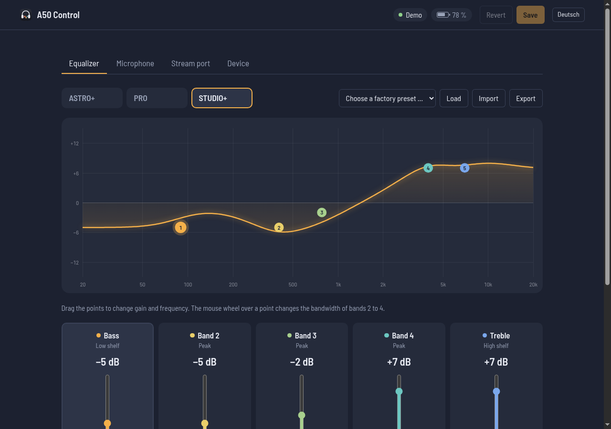

# A50 Control

Unofficial settings app for the **ASTRO A50 (Gen 4)** wireless headset. It runs in the
browser on Windows, macOS, Linux and ChromeOS, and there is a native desktop app for Linux.

> **Use it online, nothing to install:** **<https://demoriaan.github.io/astro-a50-control/>**
> Plug the base station in via USB, open the page in Chrome or Edge and click
> *Connect base station*. Without a headset you can look around in the demo:
> <https://demoriaan.github.io/astro-a50-control/?demo>

[Deutsche Version weiter unten](#deutsch)



## Features

* **Equalizer** – 3 preset slots, 5 bands (bass shelf, 3 peaking bands, treble shelf) with
  gain ±12 dB, frequency 80–15 000 Hz and bandwidth; interactive curve (drag the points, mouse
  wheel = bandwidth), rename presets, ASTRO factory presets, import/export of ASTRO Command
  Center `.ini` preset files
* **Microphone** – USB mic level, sidetone, noise gate (Streaming/Night/Home/Tournament),
  mic EQ (Bright/Airy/Warm)
* **Stream port** – output mix of game, chat, mic and AUX
* **Device** – headset on/docked, battery, live balance, default balance, alert tones,
  LED brightness, auto power-off, base and headset firmware
* Changes apply immediately; **Save** stores them on the headset, **Revert** restores the
  saved state
* Linux desktop app with a command line for scripts: `a50control status`, `a50control preset 2`, …

Supported: base station `9886:002c` (tested with firmware 40372).
Not supported: firmware updates (left out on purpose), older or newer A50 generations.

## Web app

<https://demoriaan.github.io/astro-a50-control/>

* **Browser:** a Chromium-based desktop browser – Chrome, Edge, Opera and others. Firefox,
  Safari and mobile browsers have no WebHID.
* **Operating system:** anything that runs such a browser: Windows, macOS, Linux, ChromeOS.
  Tested on Linux so far; Windows and macOS use the same browser API and should work as well.
* **Linux only:** a one-time udev rule so the browser may open the device (the page shows the
  command; same rule as [`data/70-astro-a50.rules`](data/70-astro-a50.rules)).
* Close other software that talks to the base station first (ASTRO Command Center, G HUB,
  the desktop app). Two programs at once would receive each other's answers; the app detects
  this and disconnects.
* English and German interface: German if the browser's preferred language is German,
  English otherwise; the button at the top right switches and remembers the choice.
* The page is static and talks only to the headset: strict Content Security Policy, no
  network requests, no tracking.

Run it locally:

```sh
python3 -m http.server 8642 --bind 127.0.0.1 --directory web   # then http://localhost:8642/
```

## Linux desktop app


Requirements: Python 3.10+, PyGObject, GTK ≥ 4.10, libadwaita ≥ 1.4

```sh
# Arch/Manjaro
sudo pacman -S python-gobject gtk4 libadwaita
# Debian 13 / Ubuntu 24.04+
sudo apt install python3-gi gir1.2-gtk-4.0 gir1.2-adw-1
# Fedora
sudo dnf install python3-gobject gtk4 libadwaita

./install.sh
```

`install.sh` installs into `~/.local` (including a menu entry) and sets up the udev rule
[`data/70-astro-a50.rules`](data/70-astro-a50.rules) once via `sudo`. Without it only root
may access the base station. Uninstall: `./install.sh --uninstall`.

**Flatpak** (for distributions with an older GTK/libadwaita; needs the GNOME 48 runtime and
the udev rule on the host as well):

```sh
scripts/build-flatpak.sh
flatpak install --user dist/a50control.flatpak
```

Run without installing: `python3 -m a50control`

### Command line

```text
a50control status                     show all values
a50control preset 1|2|3               activate an EQ preset
a50control slider sidetone 20         level 0–100 (stream_mic, stream_chat, stream_game,
                                      stream_aux, mic_level, sidetone)
a50control noise-gate home            streaming | night | home | tournament
a50control mic-eq warm                bright | airy | warm
a50control save                       store the current state on the headset
```

GUI, command line and web app cannot talk to the base station at the same time.

## Notes

* The drawn EQ curve is an approximation (standard shelf/peaking filters); how the headset
  DSP interprets the bandwidth value exactly is not known.
* Every setting exists as a live and a saved copy on the headset; without *Save*, changes are
  lost when the headset powers off.
* The protocol is documented in [docs/PROTOCOL.md](docs/PROTOCOL.md).

## Development

```sh
node --test web/test/*.test.js           # web app tests
python3 -m unittest discover -s tests    # desktop app tests
scripts/probe.py                         # read-only raw queries to the base station
```

The workflow `.github/workflows/pages.yml` runs both test suites and publishes `web/` on
GitHub Pages.

## Related projects

[eh-fifty](https://github.com/tdryer/eh-fifty) (Python library using PyUSB) and
[astro-a50-gui](https://github.com/OJambrina/astro-a50-gui) (PyQt6 interface on top of eh-fifty)
control the same base station. A50 Control is an independent implementation; the command codes
match ([comparison](docs/PROTOCOL.md#cross-check-with-eh-fifty)). Differences: eh-fifty does not
cover LED brightness and auto power-off, and A50 Control uses hidraw/WebHID instead of PyUSB, so
the kernel driver stays bound. Note: eh-fifty documents the game/chat balance the other way
round – checked with an audio test, 255 means game only.

Not affiliated with ASTRO Gaming or Logitech. Use at your own risk. License: [MIT](LICENSE).

---

## Deutsch

Inoffizielle Einstellungs-App für das **ASTRO A50 (Gen 4)** Wireless-Headset. Sie läuft im
Browser unter Windows, macOS, Linux und ChromeOS; für Linux gibt es zusätzlich eine
Desktop-App.

**Direkt online nutzen, ohne Installation:** <https://demoriaan.github.io/astro-a50-control/>
– Basisstation per USB anschließen, Seite in Chrome oder Edge öffnen, *Basisstation verbinden*
klicken. Ohne Headset ansehen: <https://demoriaan.github.io/astro-a50-control/?demo>

**Funktionen:** Equalizer mit 3 Preset-Plätzen und 5 Bändern (Pegel, Frequenz, Bandbreite,
interaktive Kurve, Werks-Presets, `.ini`-Import/Export im Format des ASTRO Command Center),
Mikrofon (Pegel, Sidetone, Noise Gate, Mikrofon-EQ), Stream-Port-Mix, Balance, Hinweistöne,
LED-Helligkeit, automatische Abschaltung, Akku- und Firmware-Anzeige. Änderungen wirken
sofort; *Speichern* schreibt sie dauerhaft ins Headset.

**Web-App:** braucht einen Chromium-Browser am Desktop (Chrome, Edge, Opera …); Firefox,
Safari und Mobilbrowser können kein WebHID. Getestet unter Linux; Windows und macOS nutzen
dieselbe Browser-Schnittstelle. Unter Linux ist einmalig eine udev-Regel nötig, die Seite
zeigt den Befehl. Andere Programme, die mit der Basisstation sprechen (ASTRO Command Center,
G HUB, Desktop-App), vorher schließen. Die Oberfläche ist deutsch, wenn der Browser Deutsch als
bevorzugte Sprache meldet, sonst englisch; der Knopf oben rechts schaltet um.

**Linux-Desktop-App:** GTK4/libadwaita, Installation mit `./install.sh` (Abhängigkeiten und
Kommandozeile siehe [oben](#linux-desktop-app)), alternativ als Flatpak.

Nicht mit ASTRO Gaming oder Logitech verbunden. Nutzung auf eigene Gefahr. Lizenz: MIT.
