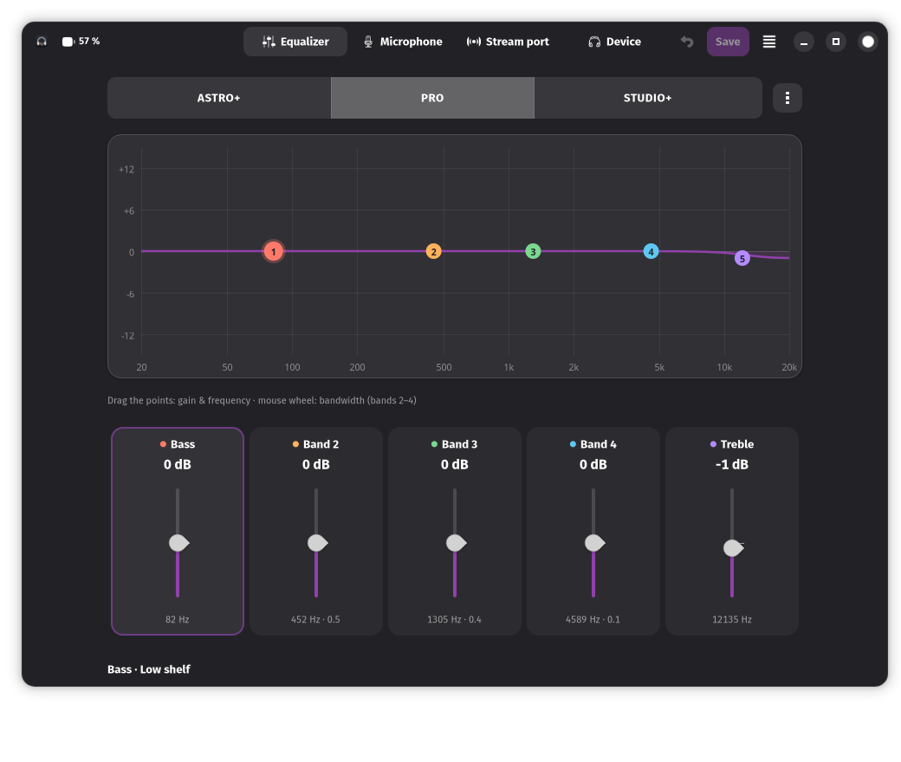

# A50 Control

Inoffizielle Linux-App für das **ASTRO A50 (Gen 4)** Wireless-Headset – Ersatz für das
Windows-only „ASTRO Command Center“. Das HID-Protokoll wurde aus `AstroCommandCenter.exe`
rekonstruiert und am echten Gerät geprüft (Details: [docs/PROTOCOL.md](docs/PROTOCOL.md)).



## Funktionen

* **Equalizer** – 3 Preset-Slots, 5 Bänder (Bass-Shelf, 3 Glocken, Höhen-Shelf) mit Pegel
  ±12 dB, Frequenz 80–15 000 Hz und Bandbreite; interaktive Kurve (Punkte ziehen, Mausrad =
  Bandbreite), Presets umbenennen, Werks-Presets aus dem ACC, Import/Export im ACC-`.ini`-Format
* **Mikrofon** – USB-Mikrofonpegel, Sidetone, Noise Gate (Streaming/Night/Home/Tournament),
  Mikrofon-EQ (Bright/Airy/Warm)
* **Stream-Port** – Ausgangsmix für Spiel, Chat, Mikrofon und AUX
* **Gerät** – Headset an/im Dock, Akkustand, Live-Balance, Standard-Balance, Hinweistöne,
  LED-Helligkeit, automatische Abschaltung, Firmware von Basis und Headset
* Änderungen wirken sofort; **Speichern** schreibt sie dauerhaft ins Headset,
  **Verwerfen** holt den gespeicherten Stand zurück
* Kommandozeile für Skripte: `a50control status`, `a50control preset 2`, …

Unterstützt: Basisstation `9886:002c` („Mimas“-Firmware, getestet mit FW 40372).
Nicht unterstützt: Firmware-Updates (bewusst weggelassen), ältere/neuere A50-Generationen.

## Installation

Voraussetzung: Python 3.10+, PyGObject, GTK ≥ 4.10, libadwaita ≥ 1.4

```sh
# Arch/Manjaro
sudo pacman -S python-gobject gtk4 libadwaita
# Debian 13 / Ubuntu 24.04+
sudo apt install python3-gi gir1.2-gtk-4.0 gir1.2-adw-1
# Fedora
sudo dnf install python3-gobject gtk4 libadwaita

./install.sh
```

`install.sh` installiert nach `~/.local` (Startmenü-Eintrag inklusive) und richtet einmalig
per `sudo` die udev-Regel [`data/70-astro-a50.rules`](data/70-astro-a50.rules) ein. Ohne sie
darf nur root auf die Basisstation zugreifen. Deinstallieren: `./install.sh --uninstall`.

**Flatpak** (für Distributionen mit zu altem GTK/libadwaita, braucht die GNOME-48-Runtime
und ebenfalls die udev-Regel auf dem Host):

```sh
scripts/build-flatpak.sh
flatpak install --user dist/a50control.flatpak
```

Ohne Installation starten: `python3 -m a50control`

## Kommandozeile

```text
a50control status                     alle Werte anzeigen
a50control preset 1|2|3               EQ-Preset aktivieren
a50control slider sidetone 20         Pegel 0–100 (stream_mic, stream_chat, stream_game,
                                      stream_aux, mic_level, sidetone)
a50control noise-gate home            streaming | night | home | tournament
a50control mic-eq warm                bright | airy | warm
a50control save                       aktuellen Stand im Headset speichern
```

GUI und Kommandozeile können nicht gleichzeitig mit der Basisstation sprechen
(exklusiver Zugriff, sonst vermischen sich die Antworten).

## Hinweise

* Die gezeichnete EQ-Kurve ist eine Näherung (Standard-Shelf/Glockenfilter); wie die
  Headset-DSP die Bandbreite genau interpretiert, ist nicht bekannt.
* Alle Einstellungen existieren als Live- und als gespeicherte Kopie im Headset; ohne
  „Speichern“ gehen Änderungen beim Ausschalten verloren.
* Entwicklerwerkzeuge: `scripts/probe.py` (nur lesende Rohabfragen),
  `scripts/re/vtables.py` (RTTI-Vtables im ACC-Binary finden), `python3 -m unittest discover -s tests`.

## Verwandte Projekte

[eh-fifty](https://github.com/tdryer/eh-fifty) (Python-Bibliothek über PyUSB) und
[astro-a50-gui](https://github.com/OJambrina/astro-a50-gui) (PyQt6-Oberfläche auf eh-fifty) steuern
dieselbe Basisstation. A50 Control ist unabhängig aus dem ACC-Binary rekonstruiert; die
Befehlscodes stimmen überein (Abgleich in [docs/PROTOCOL.md](docs/PROTOCOL.md#cross-check-with-eh-fifty)).
Unterschiede: eh-fifty kennt LED-Helligkeit und Auto-Abschaltung nicht; A50 Control nutzt hidraw
statt PyUSB (der Kernel-Treiber bleibt gebunden). Achtung: eh-fifty dokumentiert die
Spiel/Chat-Balance spiegelverkehrt – per Audio-Test geprüft gilt 255 = nur Spiel.

Nicht mit ASTRO Gaming oder Logitech verbunden. Nutzung auf eigene Gefahr.
